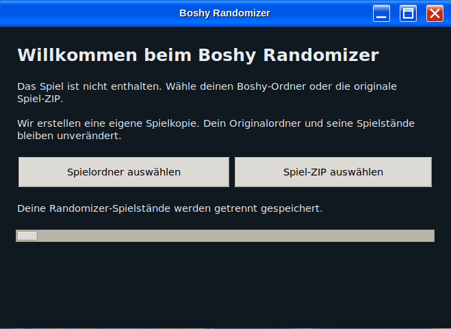

# Boshy Randomizer

[Linux download — 2026.10.13 RC1](https://github.com/THXel/Boshy-Randomizer/releases/tag/v2026.10.13-rc1) · [DEB](https://github.com/THXel/Boshy-Randomizer/releases/download/v2026.10.13-rc1/boshy-randomizer_2026.10.13-1_amd64.deb)

[Deutsch](README/README_DE.md) · [Русский](README/README_RU.md) · [Español](README/README_ES.md) · [日本語](README/README_JP.md)


A fan-made randomizer for **I Wanna Be The Boshy**, created by **THXel and the Boshy speedrunning community**. Original game by Solgryn / Grynsoft.

## Linux package

The current version integrates run setup into the **original animated game menu**. The Debian package targets **Linux Mint 22.x / Ubuntu 24.04, amd64, X11**. **The updated Windows version will follow.** The Windows executables in the repository root belong to the legacy version.

Install the downloaded package using your graphical package manager, or:

```sh
sudo apt install ./boshy-randomizer_2026.10.13-1_amd64.deb
```

APT installs Wine, Lutris and the required desktop/Python libraries. Launch **Boshy Randomizer** from the applications menu. At first launch:

1. Select your Boshy game **folder or ZIP**. The original game is **not included or downloaded**.
2. Setup verifies the supported executable and copies it into a separate randomizer installation. Original saves, profiles and settings are not imported or changed.
3. Setup automatically downloads the pinned **Wine Staging 11.2 WoW64** runner (about 72 MiB), verifies its SHA-256 and prepares a private Wine prefix. An identical existing Lutris runner is reused. Internet access is required for dependencies and the initial Wine download.
4. Choose one of three save slots and configure your run in the game menu.

Boshy runs with DXVK, Esync and Fsync disabled, matching the working reference setup. Lutris does not need to remain open. Runtime files and saves live in `~/.local/share/boshy-randomizer/`; the runner lives under `~/.local/share/lutris/runners/wine/`. Removing the Debian package preserves these user files. This package does not automatically migrate a previous development installation.

## Screenshots

Actual captures from the Linux Mint test VM (German UI). Its limited VM resources are not representative of gameplay performance.




## Features

- Three independent saves, per-run character profiles, save summaries and deletion with a backup.
- **Randomizer:** engine-state level/boss transitions, advanced route pools and mixed item/character rewards.
- **Target Select:** random item goals with configurable count and optional boss goals; original item placements, randomized positions and a final Solgryn fight.
- Portable **BR2 seeds** include run settings and can be copied or pasted from the game menu and tracker.
- Optional character randomization and projectile/effect randomization on transitions, deaths or configurable random time intervals.
- Advanced comfort/training options, original game options, end-of-run results and a separate compact live tracker.
- Optional **Ctrl+Alt+D debug window** with live state, test actions and exportable recordings.
- Automatic English, German, Russian, Spanish and Japanese UI; unsupported languages fall back to English. **Update logs always stay English.**

Original game text/artwork, item/character names and canonical difficulty names remain unchanged. Language does not affect seeds or rules. The external PinguLexa/OBS integration is maintained separately and is not installed by this package.

## Development

Current source: [`native-linux/`](native-linux/). Build and test instructions, dependency provenance and verification status: [Linux packaging](docs/LINUX_PACKAGE.md) and [release preparation](docs/RELEASE_PREPARATION.md).

```sh
python3 -m unittest discover -s native-linux/tests -v
python3 -m compileall -q native-linux
```

See also [localization](docs/LOCALIZATION.md), [changelog](CHANGELOG.md) and [legacy Windows documentation](docs/LEGACY_WINDOWS_README.md).

## Game and assets

The importer accepts the supported executable with SHA-256 `dc6a1a551254f1d1003d14c0bf58f639a7ea94f99f74b5c635ddaf9bc4ec0806`. Other versions are rejected before installation. Supply your own compatible game copy. Preserve the existing attribution in [Custom/License.txt](Custom/License.txt); this project does not add a license grant for the original game or third-party art.
