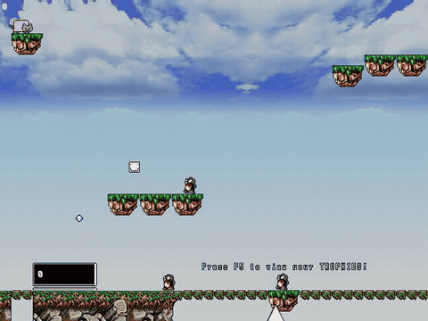
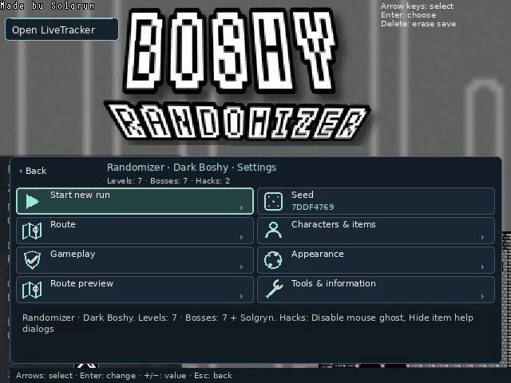
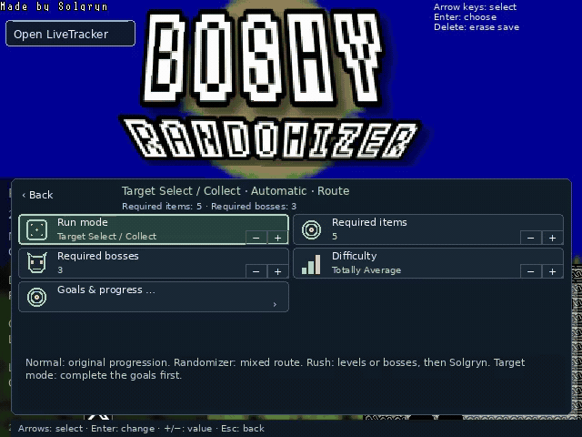
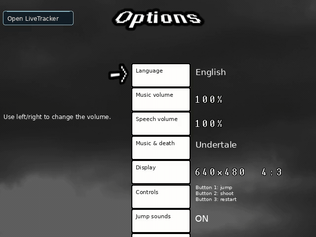
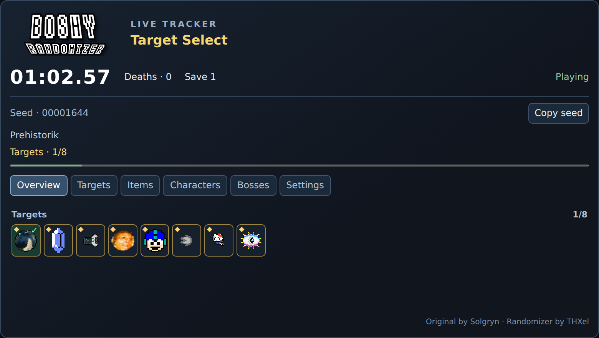
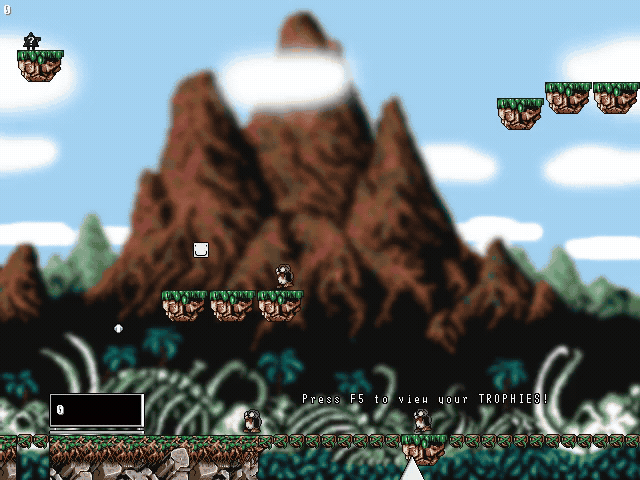

# Boshy ist zurück.

**Kram Boshy wieder raus. Jeder Seed ein neues Abenteuer.**

[English](README_EN.md) · [Deutsch](README_DE.md) · [Español](README_ES.md) · [Русский](README_RU.md) · [日本語](README_JP.md)

[Website](https://thxel.github.io/Boshy-Randomizer/site/de/)

Boshys Welten und Bosse in neuer Reihenfolge, Überraschungen in jeder Truhe. Stell dir deinen Lauf zusammen und teile ihn mit Freunden.

> **Erste finale Version · in Vorbereitung**
>
> Die erste finale Version kommt bald. Hier bekommst du schon einen Vorgeschmack.

## Fünf Arten, Boshy zu spielen

| | |
| --- | --- |
| **Randomizer** | Gemischte Level, Bosse und Truhen – bis zum Finale gegen Solgryn. |
| **Target Select** | Finde die gesuchten Items und besiege deine Bossziele, um Solgryn zu erreichen. |
| **Normal** | Spiel den originalen Weg, auf Wunsch mit deinen Lieblingsextras. |
| **Boss Rush** | Ein Boss nach dem anderen. Du wählst, wer dabei ist. |
| **Level Rush** | Spring durch deine Levelauswahl. Zum Schluss wartet Solgryn. |

## Was wartet hinter dem nächsten Ausgang?

- **Neue Wege durch Boshy:** Level, Bosse und Geheimwege werden neu gemischt. Du entscheidest, welche dabei sind.
- **Jede Truhe eine Überraschung:** Ein Item oder ein neuer Charakter? Im Randomizer weißt du es erst, wenn du sie öffnest.
- **Gleicher Seed. Wer ist schneller?:** Teile deinen Seed mit Freunden und tretet auf derselben Route gegeneinander an.
- **Platz für drei Runs:** Ein Lauf zum Üben, einer fürs Rennen, einer fürs Chaos. Setz jederzeit dort fort, wo du aufgehört hast.
- **Dein Fortschritt im Blick:** Zeit, Tode und gesammelte Items im LiveTracker – auch für deinen Stream.
- **Solgryn wartet am Ende:** Schaff es bis zum Finale und sieh dir an, wie du dich geschlagen hast.

## Dein Run. Deine Einstellungen.

## Deine Ziele direkt im Spiel

## Spiel so, wie es dir passt

## Dein Run auf einen Blick

Zeit, Tode, Items und Ziele — neben dem Spiel oder in OBS. Öffne den LiveTracker direkt aus dem Spielmenü.

## Boshy, bunt durcheinander

Vertraute Welten bekommen andere Hintergründe, Farben und Sprites. Du bestimmst, wie wild es wird.

Lass deine Schüsse unterwegs wechseln und misch die Musik neu. Originalmusik oder Undertale? Du entscheidest. Optionale Packs für Kamilia 3 und WannaFest22 bringen ihre Musik und Todeseffekte mit.

[Video mit Ton](https://thxel.github.io/Boshy-Randomizer/site/media/death-undertale.mp4) · [Ein Blick ins Spiel](https://thxel.github.io/Boshy-Randomizer/site/de/#gallery)

## Ein bisschen Hilfe. Ein bisschen Chaos.

Wähle im Spielmenü optionale Extras fürs Training oder für eine andere Herausforderung.

Störende Item-Pop-ups unterdrücken · Mausgeist deaktivieren · Bosse mit 1 HP pro verwundbarer Phase · God Mode · Dauerfeuer bei gehaltener Schusstaste · Spiegelmodus · Charakterwechsel nach Tod · Boss-Intros automatisch überspringen · Truhenanimation verkürzen · Musik mischen · Sprite-Chaos konfigurieren · Spinnen-Überraschung · Bildschirmwackeln ausschalten

## Spiel so, wie es dir passt

Maus oder Tastatur · Fenster oder Vollbild mit F4 · Klassisch 4:3 oder gestreckt 16:9 · Fünf Sprachen

## Wähle deine Plattform

**Windows (.exe) · Linux (.deb) — Bald verfügbar**

Du brauchst deinen eigenen Boshy-Ordner oder eine ZIP. Das Originalspiel ist nicht enthalten. [I Wanna Be The Boshy bei Grynsoft herunterladen](https://grynsoft.com/site/game/i-wanna-be-the-boshy)

Der Randomizer legt eine eigene Spielkopie an. Dein Originalspiel und seine Spielstände bleiben getrennt.

## Gut zu wissen

Kann ich damit streamen?

Ja. Öffne den eingebauten LiveTracker im Spielmenü und nutze ihn im Browser oder als Browserquelle in OBS.

Was tun, wenn ein Trigger nicht passt?

Öffne die Diagnose im Spielmenü und ergänze deine GitHub-Meldung um Modus, Seed und eine Beschreibung des Problems.

Wer hat den Randomizer bisher getestet?

Bisher hat THXel den Randomizer allein getestet. Die letzten Tests vor der ersten finalen Version laufen.

Wann kann ich ihn herunterladen?

Die erste finale Version wird vorbereitet. Sobald sie fertig ist, stehen hier Windows-Setup und Linux-DEB bereit. Ein Veröffentlichungstermin steht noch nicht fest.

Kann man online spielen?

Dies ist ein Einzelspieler-Randomizer. Das alte Boshy-Online-Menü ist deaktiviert. Über Seed-Codes könnt ihr vergleichbare Läufe mit Freunden spielen.

---

Randomizer-Mod von THXel. Original I Wanna Be The Boshy von Solgryn / Grynsoft.

[Frage oder Idee teilen](https://github.com/THXel/Boshy-Randomizer/issues) · [Credits](../Custom/License.txt)
