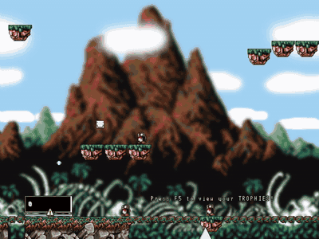
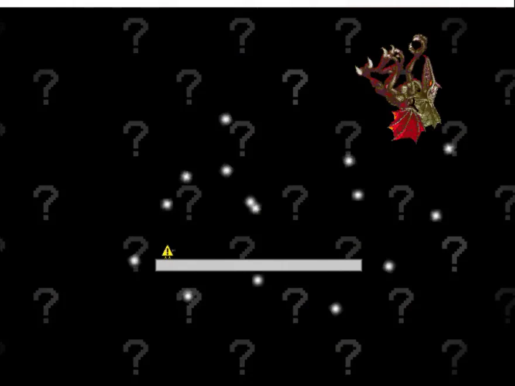

# Boshy ist zurück.

**Kram Boshy wieder raus. Jeder Seed ein neues Abenteuer.**

[English](README_EN.md) · [Deutsch](README_DE.md) · [Español](README_ES.md) · [Русский](README_RU.md) · [日本語](README_JP.md)

[🌐 Website](https://thxel.github.io/Boshy-Randomizer/site/de/) · [↓ Windows-Setup](https://github.com/THXel/Boshy-Randomizer/releases/download/v2026.10.23/BoshyRandomizer-2026.10.23-Windows-Setup-x64.exe) · [↓ Linux-DEB](https://github.com/THXel/Boshy-Randomizer/releases/download/v2026.10.23/boshy-randomizer_2026.10.23-1_amd64.deb) · [Release & Prüfsummen](https://github.com/THXel/Boshy-Randomizer/releases/tag/v2026.10.23)

Vertraute Welten. Unbekannte Wege. Entdecke I Wanna Be The Boshy mit gemischten Begegnungen, überraschenden Belohnungen und einem Lauf, den du mit Freunden teilen kannst.

> Du brauchst deinen eigenen Boshy-Ordner oder eine ZIP. Das Originalspiel ist nicht enthalten.
>
> [I Wanna Be The Boshy bei Grynsoft herunterladen](https://grynsoft.com/site/game/i-wanna-be-the-boshy)

[Spielmodi](#modes) · [Funktionen](#features) · [Hacks](#hacks) · [Download](#download) · [FAQ](#faq)

## Fünf Arten, Boshy zu spielen

| Mode | |
| --- | --- |
| **Randomizer** | **Das vertraute Spiel, neu gemischt.** Level- und Bossziele werden gemischt; Item- und Charaktertruhen teilen sich einen Belohnungspool. Im Advanced-Menü wählst du Abschnitte und Anzahl. Empfohlen: sieben Level und sieben Bosse, soweit die Auswahl es erlaubt abwechselnd, danach Solgryn. |
| **Target Select** | **Eine Zielliste. Ein unvorhersehbarer Weg.** Sammle eine zufällige Liste originaler Items mit einstellbarer Anzahl und optionalen Bosszielen. Die Ziele wechseln, die Truhenbelohnungen bleiben original. Erst wenn alle Vorgaben erfüllt sind, geht es ins Solgryn-Finale. |
| **Normal** | **Dein Weg. Deine Regeln.** Originaler Spielverlauf und originale Truhen. Startcharakter, Charakterwechsel und Hacks sind optional. Diese Extras sind im Normal-Modus zunächst ausgeschaltet. |
| **Boss Rush** | **Direkt zu den Kämpfen.** Wähle Bossauswahl und Anzahl der Begegnungen. Standard sind sieben. Nach den gewählten Kämpfen wartet Solgryn als Finale. |
| **Level Rush** | **Die Welten sind deine Herausforderung.** Wähle Levelauswahl und Anzahl der Abschnitte. Standard sind sieben. Danach folgt Solgryn als Finale. |

## Mach jeden Lauf zu deinem Lauf

### Mehr als der normale Weg

Geteilte Welten, Minibosse und Geheimwege treffen auf Beta-Kämpfe wie Ridley, Questionmark, Bomberman und Old Sonic. Im Advanced-Menü bestimmst du die Auswahl. Übergänge lesen den Spielzustand statt Bildschirm-Pixel.

### Items und Charaktere in einem Pool

Jede Truhe kann ein Item oder einen Charakter enthalten, unabhängig vom ursprünglichen Typ. Der optionale Charakterwechsel nutzt deinen verfügbaren Pool; neu gesammelte Charaktere kommen hinzu. Während der Rotation ist die manuelle F3-Auswahl gesperrt.

### Ein Seed zum Teilen

Kompakte Codes enthalten Seed und Laufeinstellungen. Im Spielmenü kannst du sie kopieren, einfügen, prüfen, als Vorschau ansehen oder neu generieren. Für vergleichbare Läufe verwendet ihr dieselbe Randomizer-Version.

### Drei Slots. Drei Abenteuer.

Jeder Speicherplatz hat einen eigenen Lauf und eigene Charakterfreischaltungen. Die Übersicht zeigt Ort, Schwierigkeit, aktuellen Charakter und Fortschritt. Fortsetzen, anlegen und löschen geht im nativen Menü.

### Ein Tracker neben dem Spiel

Ein separates Fenster hält die Spielfläche frei: Timer, Tode, Ort, gesammelte Items und Charaktere, Bossfortschritt und Seed-Kopieren. Es passt sich dem Modus an, hebt Target-Select-Ziele hervor und zeigt neue Funde mit einer Animation.

### Ein Finale, das du genießen kannst

Nach Solgryn erscheint zeitversetzt eine leicht transparente Übersicht mit Seed, Laufstatistik und Kopierfunktion. Sterbeanimation und Credits laufen dahinter weiter.

### Vertrautes Spiel, ungewohnter Look

Neue Intro-Charaktere und Kulissen beim Start. Das optionale Sprite-Chaos mischt geprüfte Hintergründe samt animierter Parallaxe, Dekoration und Plattform-Materialien. Die Ebenen sind einzeln einstellbar, Hintergründe lassen sich abdunkeln. Farbwechsel für Gegner und Bosse sind Beta; Formen, Angriffe und Kollisionen bleiben erhalten.

### Neue Schüsse. Neuer Sound.

Projektil und Schusseffekt wechseln unabhängig vom Charakter: nach einem Spot, nach einem Tod, nach beidem oder zufällig innerhalb einer selbst gewählten Zeitspanne. Sekunden und Minuten sind einstellbar; Standard sind fünf Minuten.

Music Shuffle mischt Level- und Bossmusik gemeinsam mit einer Zuordnung über den Seed. Lokal installierte Kamilia-3- und WannaFest22-Soundpacks können außerdem passende Intro-, Menü-, Todes- und Abspann-Sounds ersetzen. Die Auswahl bleibt gespeichert; Shuffle-Titel müssen länger als 30 Sekunden sein. Diese zusätzlichen Soundpacks sind nicht im Download enthalten. Lokal importierte Pack-Grafiken ergänzen animierte Todesanzeigen und Blutpartikel: Kamilia blendet zuerst Rot und dann die Schrift ein, WannaFest lässt die Schrift über VHS-Rauschen einschlagen. Das ursprüngliche Reset-Verhalten bleibt erhalten.

## Ein bisschen Hilfe. Ein bisschen Chaos.

Unter Advanced → Hacks wählst du optionale Extras für Training, Abwechslung oder eine kleine Überraschung.

- Störende Item-Pop-ups unterdrücken
- Mausgeist deaktivieren
- Bosse mit 1 HP pro verwundbarer Phase
- God Mode
- Dauerfeuer bei gehaltener Schusstaste
- Spiegelmodus
- Charakterwechsel nach Tod
- Boss-Intros automatisch überspringen
- Truhenanimation verkürzen
- Musik mischen
- Sprite-Chaos konfigurieren
- Spinnen-Überraschung

> Die Spinnen-Überraschung ist bei neuen Randomizer-Läufen zunächst an: ein unangekündigter Angriff alle 5–30 aktiven Spielminuten, auch bei Bossen. Ausschalten und übernehmen merkt sich die Wahl für zukünftige Läufe. Gespeicherte Läufe und importierte Seeds behalten ihre Regeln.

### So bedienbar, wie du spielst

- Maus-Hover und Tastaturnavigation; Enter bestätigt die Auswahl.
- Menüs passen sich ans Spielfenster an, die Schriftgröße lässt sich separat wählen.
- Moderne, zum Monitor passende Größen im originalen Optionsmenü; gestrecktes Vollbild bleibt verfügbar.
- Deutsch, Englisch, Russisch, Spanisch und Japanisch mit Systemerkennung und Englisch als Fallback. Update-Logs bleiben Englisch.

## Boshy in Bewegung

Öffne eine Vorschau für die vollständige Animation. Die Todesvideos enthalten Ton; GIFs sind stumm. Die Wiedergabe startet erst beim Öffnen einer Vorschau.

### Kamilia 3: rote Blende, Game Over und Todessound

[Video mit Ton](https://thxel.github.io/Boshy-Randomizer/site/media/death-kamilia3.mp4)

### WannaFest22: VHS-Rauschen, Titelanimation und Todeswürfel

[Video mit Ton](https://thxel.github.io/Boshy-Randomizer/site/media/death-wannafest22.mp4)

[Boshy in Bewegung](https://thxel.github.io/Boshy-Randomizer/site/de/#gallery)

## Wähle deine Plattform

| | Download | |
| --- | --- | --- |
| **Windows** | [Windows-Setup](https://github.com/THXel/Boshy-Randomizer/releases/download/v2026.10.23/BoshyRandomizer-2026.10.23-Windows-Setup-x64.exe) | Windows-Vorschau · x64 |
| **Linux** | [Linux-DEB](https://github.com/THXel/Boshy-Randomizer/releases/download/v2026.10.23/boshy-randomizer_2026.10.23-1_amd64.deb) | Linux Mint 22 / Ubuntu 24.04 · X11 · amd64 |

[Release & Prüfsummen](https://github.com/THXel/Boshy-Randomizer/releases/tag/v2026.10.23) · [Windows](../docs/WINDOWS_PACKAGE.md) · [Linux](../docs/LINUX_PACKAGE.md)

### Vom Download zum ersten Lauf

1. Lade das Windows-Setup oder die Linux-DEB herunter.
2. Installiere und starte Boshy Randomizer über dein Anwendungsmenü. Unter Windows kannst du zusätzlich eine Desktop-Verknüpfung anlegen.
3. Wähle deinen unterstützten Boshy-Ordner oder eine ZIP, suche einen Speicherplatz aus und stelle deinen Lauf zusammen.

Der Randomizer legt eine eigene Spielkopie an. Originalspielstände bleiben unberührt; Updates und Deinstallation behalten die Randomizer-Spielstände.

## Gut zu wissen

Kann ich damit streamen?

Der eingebaute Live-Tracker ist ein separates Fenster: neben das Spiel stellen oder in OBS erfassen.

Was tun, wenn ein Trigger nicht passt?

Strg+Alt+D öffnet die Diagnose mit Live-Daten, Testaktionen und exportierbaren Aufzeichnungen. Strg+Alt+M markiert ein Problem und speichert den jüngsten Verlauf ohne ein Fenster zu öffnen. Berichte können einen Screenshot nur vom Spiel enthalten.

Ist jede Kombination getestet?

369 automatische Quellcode-Tests bestehen. Windows-Installation, Update, Deinstallation, Datenerhalt und Fortsetzen wurden mit aktivem Defender geprüft. Die Linux-Paketprüfungen stehen in den Release-Hinweisen. Nicht jede komplette Route und Hackkombination wurde durchgespielt.

Was bedeutet Windows-Vorschau?

Der Installer ist unsigniert und wurde unter Windows 10 x64 getestet. Windows 11, Kontopfade mit Sonderzeichen, echte 4K-Anzeigen und gemischte DPI benötigen noch eigene Tests. Virenschutz eingeschaltet lassen.

Kann man online spielen?

Dies ist ein Einzelspieler-Randomizer. Das alte Boshy-Online-Menü ist deaktiviert. Über Seed-Codes könnt ihr vergleichbare Läufe mit Freunden spielen.

---

Ein Fanprojekt von THXel und der Boshy-Speedrun-Community. Originalspiel von Solgryn / Grynsoft.

[Problem melden](https://github.com/THXel/Boshy-Randomizer/issues) · [Änderungsverlauf](../CHANGELOG.md) · [Credits](../Custom/License.txt) · [Development](../docs/DEVELOPMENT.md)
