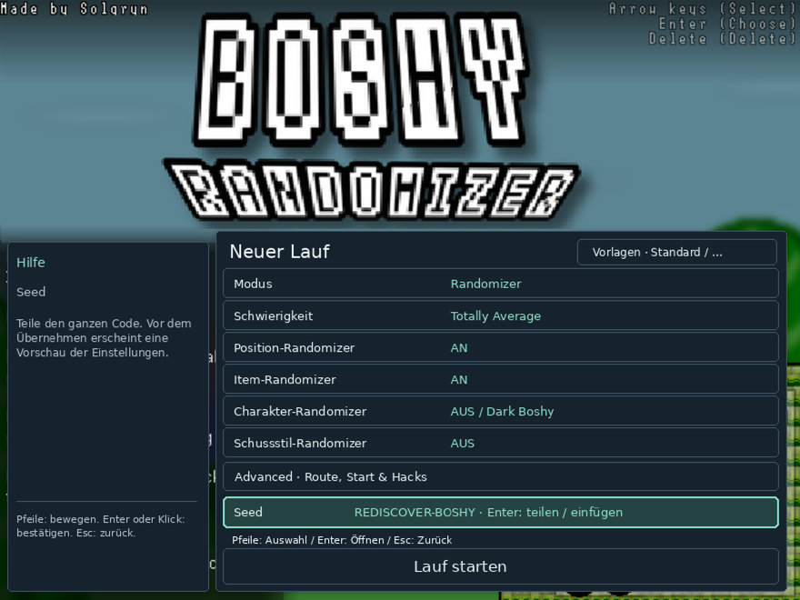

# Boshy ist zurück.

[English](README_EN.md) · [Deutsch](README_DE.md) · [Русский](README_RU.md) · [Español](README_ES.md) · [日本語](README_JP.md)

**Kram Boshy wieder raus. Jeder Seed ein neues Abenteuer.**

Du kennst *I Wanna Be The Boshy* in- und auswendig? Dann entdecke seine Welten, Bosse und Geheimnisse noch einmal neu. Spiele eine gemischte Route, jage einer zufälligen Zielliste hinterher oder teile deinen Seed mit Freunden. Ein paar optionale Überraschungen sorgen dafür, dass selbst alte Hasen nicht alles kommen sehen.

[Linux-DEB herunterladen](https://github.com/THXel/Boshy-Randomizer/releases/download/v2026.10.15/boshy-randomizer_2026.10.15-1_amd64.deb) · [Release & Prüfsummen](https://github.com/THXel/Boshy-Randomizer/releases/tag/v2026.10.15)

**Linux Mint 22.x / Ubuntu 24.04 · amd64 · X11**

[Windows-Setup herunterladen (Vorschau)](https://github.com/THXel/Boshy-Randomizer/releases/download/v2026.10.18-windows-preview/BoshyRandomizer-2026.10.18-Windows-Setup-x64.exe)

**Windows-Vorschau für x64:** Installiere mit dem Setup-Assistenten und starte **Boshy Randomizer** über das Startmenü oder die optionale Desktop-Verknüpfung. Keine CMD und keine Installation von Python, Wine oder Lutris nötig. Beim ersten Start wählst du deinen Boshy-Ordner oder eine ZIP; das Spiel ist nicht enthalten. Updates und Deinstallation behalten Spielstände. Defender blieb beim Windows-10-Test aktiv. Der Installer ist unsigniert; Windows 11 und Kontopfade mit Sonderzeichen sind noch nicht geprüft.

[Windows setup details](../docs/WINDOWS_PACKAGE.md)


## Dein Spiel, dein Lauf

| Modus | So spielst du |
| --- | --- |
| **Randomizer** | Gemischte Level- und Bossziele; Truhen können Items oder Charaktere enthalten. Im Advanced-Menü stellst du die Auswahl zusammen. Empfohlen sind sieben Level und sieben Bosse. |
| **Target Select** | Eine zufällige Item-Zielliste mit einstellbarer Anzahl und optionalen Bosszielen. Positionen werden gemischt, Items bleiben an ihren ursprünglichen Fundorten. Erst nach allen Zielen geht es zu Solgryn. |
| **Normal** | Originaler Spielverlauf und originale Truhen. Startcharakter, Charakter-Randomizer und Hacks sind optional. Rotation und Hacks sind zunächst aus; nur bei aktivierter Rotation ist F3 gesperrt. |

Drei getrennte Speicherplätze behalten Fortschritt und freigeschaltete Charaktere je Lauf. Neue Läufe stellst du direkt im originalen Spielmenü ein; belegte Slots setzt du fort. Kompakte **Seedcodes** enthalten Seed und Einstellungen – mit Vorschau und Prüfung beim Einfügen.

## Was Boshy neu macht

- Die Menüs passen sich automatisch an kleinere Spielfenster an. Über **Aa** in der Speicherplatzauswahl oder beim neuen Lauf wählst du kleine, normale oder große Schrift. Die Schriftgröße wird lokal gespeichert; Seed und Spielauflösung bleiben unverändert.
- **45 auswählbare Routenpunkte**, darunter aufgeteilte Level, Minibosse und Beta-Kämpfe wie Ridley, Questionmark und Old Sonic. Die Übergänge lesen den Spielzustand statt Bildschirm-Pixel.
- Optional wechselnde Charaktere und zufällige **Projektile samt Schusseffekt**: nach einem Spot, nach einem Tod, nach beidem oder nach zufälligen Zeitabständen mit einstellbarer Obergrenze.
- Optionaler **Musik-Randomizer** mit 45 gemeinsam gemischten Level- und Bossstücken.
- Wechselnde Intro-Charaktere, Hintergründe, Böden und dezente Effekte beim Neustart – unabhängig vom Seed.
- Hacks für Komfort oder Training: Item-Pop-ups unterdrücken, Mausgeist deaktivieren, Bossintro überspringen, Truhenanimation verkürzen, Autofire, Bosse mit 1 HP und God Mode.
- Eine seltene **Spinnenüberraschung** ist für neue Läufe zunächst an: ohne Vorwarnung, nach zufälligen 5–30 Minuten aktiver Spielzeit, auch bei Bossen. Unter **Advanced → Hacks** ausschalten und übernehmen; dann bleibt sie für neue Läufe standardmäßig aus, bis du sie wieder einschaltest. Bestehende Saves behalten ihre Einstellungen; eingefügte Seeds bringen eigene mit.
- Separater, kompakter Live-Tracker mit Sammelicons und „Copy Seed“, Ergebnisübersicht nach Solgryn und optionales Debugfenster über **Strg+Alt+D** mit exportierbaren Aufzeichnungen.
- **Strg+Alt+M** markiert ein Problem bei geschlossenem Debugfenster und speichert bis zu zwei Minuten Diagnose-Vorlauf unter `debug-reports`. Im Debugfenster lassen sich Wartezeit ab Trigger-Erkennung, Ladezeit und gesamte Übergangszeit getrennt ablesen.
- Die Grafikdiagnose kann Hintergründe, Dekoration, Böden und Gegnerfarben getrennt vorübergehend abschalten. Die Änderung gilt ab dem nächsten Levelwechsel; beim Laden eines Spielstands gelten wieder dessen Einstellungen. Problemberichte enthalten nach Möglichkeit einen Screenshot nur des Spielfensters und die letzten Grafikwechsel.


## Installation unter Linux

1. DEB oben herunterladen. Vor einem Update den Randomizer schließen.
2. Mit der Paketverwaltung öffnen oder installieren:

```sh
sudo apt install ./boshy-randomizer_2026.10.15-1_amd64.deb
```

3. **Boshy Randomizer** im Anwendungsmenü starten.
4. Beim ersten Start den eigenen unterstützten Boshy-**Ordner oder eine ZIP** auswählen. Das Spiel wird separat kopiert; ursprüngliche Spielstände bleiben unangetastet und werden nicht importiert.
5. Slot wählen, Lauf einstellen, spielen.

**Das Originalspiel ist nicht enthalten.** Wine, Lutris und benötigte Bibliotheken werden als Abhängigkeiten installiert. Die Ersteinrichtung lädt den geprüften Wine-Staging-11.2-WoW64-Runner oder nutzt eine identische vorhandene Kopie. Dafür wird Internet benötigt. Lutris muss später nicht geöffnet bleiben.

Daten liegen unter `~/.local/share/boshy-randomizer/`. Paketupdates und Deinstallation behalten deine Saves. Entwicklungsinstallationen werden nicht automatisch übernommen. [Installationsdetails](../docs/LINUX_PACKAGE.md).

## Fünf Sprachen

Die Oberfläche erkennt **Deutsch, Englisch, Russisch, Spanisch und Japanisch** anhand der Systemsprache; sonst wird Englisch verwendet. Update-Verlauf bleibt Englisch. Originaldialoge, Grafik und Charakternamen werden nicht übersetzt.



## Geprüft, ohne mehr zu versprechen

369 automatische Tests bestanden. Alle 45 Punkte wurden im Spiel geladen und zurückgesetzt. Questionmark, Ridley, Old Sonic und Solgryn wurden zusätzlich mit Trainingshacks besiegt; Spinnenzeit, Speichern/Laden und Abschlussanzeige wurden praktisch geprüft. Nicht jede komplette Route und Hackkombination wurde durchgespielt. [Prüfumfang](../docs/RELEASE_PREPARATION.md).

Ein Fanprojekt von **THXel und der Boshy-Speedrunning-Community**. Originalspiel: **Solgryn / Grynsoft**. Danke, dass ihr Boshy am Leben haltet!

[Änderungsverlauf](../CHANGELOG.md) · [Quellcode & Build](../docs/LINUX_PACKAGE.md#building) · [Fehler melden](https://github.com/THXel/Boshy-Randomizer/issues)

Aktueller Quellcode: `native-linux/`. Die PinguLexa-/OBS-Anbindung ist separat und nicht im Paket enthalten. [Unterstützte Spielversion und Grafiknachweise](../docs/LINUX_PACKAGE.md#game-and-assets), [bestehende Credits](../Custom/License.txt).
