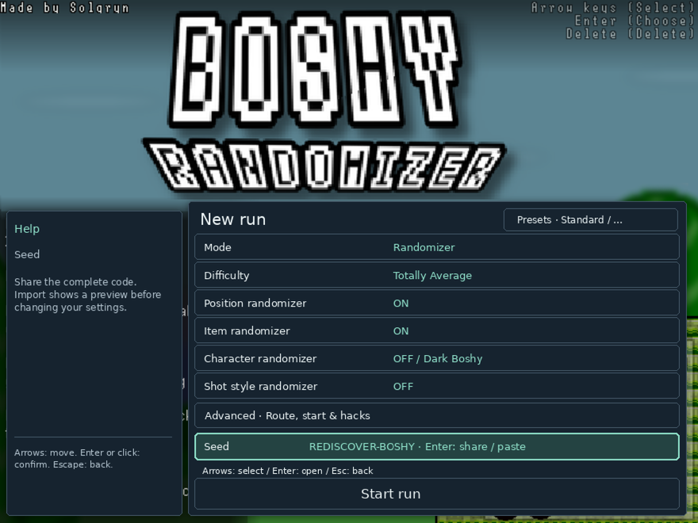

# Boshy, reborn.

[English](README_EN.md) · [Deutsch](README_DE.md) · [Русский](README_RU.md) · [Español](README_ES.md) · [日本語](README_JP.md)

**Rediscover Boshy. A new adventure with every seed.**

Dust off *I Wanna Be The Boshy* and take a different path through its worlds, bosses and secrets. Build a shuffled adventure, chase a random checklist, share your seed with friends—or let a few optional surprises turn a familiar game upside down.

[Download Linux DEB](https://github.com/THXel/Boshy-Randomizer/releases/download/v2026.10.15/boshy-randomizer_2026.10.15-1_amd64.deb) · [Release & checksums](https://github.com/THXel/Boshy-Randomizer/releases/tag/v2026.10.15)

**Linux Mint 22.x / Ubuntu 24.04 · amd64 · X11**

[Download Windows Setup (preview)](https://github.com/THXel/Boshy-Randomizer/releases/download/v2026.10.18-windows-preview/BoshyRandomizer-2026.10.18-Windows-Setup-x64.exe)

**Windows x64 preview:** install with the setup wizard, then launch **Boshy Randomizer** from the Start menu or optional desktop shortcut. No CMD, Python, Wine or Lutris installation is needed. On first launch, choose your own Boshy folder or ZIP; the game is not included. Updates and uninstall preserve saves. Defender stayed enabled during Windows 10 testing. The installer is unsigned; Windows 11 and non-ASCII account paths are not yet verified.

[Windows setup details](../docs/WINDOWS_PACKAGE.md)


## Choose your adventure

| Mode | Your run |
| --- | --- |
| **Randomizer** | Shuffle level and boss destinations. Mix items and characters across chests. Choose your route pools in Advanced; the recommended setup uses seven levels and seven bosses. |
| **Target Select** | Chase a randomly chosen item list with an adjustable size and optional boss goals. Positions change; items stay at their original locations. Reach Solgryn after completing your goals. |
| **Normal** | Original progression and chest rewards, with optional starting character, character rotation and hacks. Rotation and hacks initially stay off; F3 is locked only while character rotation is enabled. |

Three independent save slots keep each run's progress and character unlocks separate. Configure a new run inside the original game menu; resume an occupied slot where you left off. Compact **share codes** carry the seed and run settings, with an import preview and validation.

## Familiar game. New possibilities.

- Menus adapt automatically to smaller game windows. Use **Aa** in the save selection or new-run menu for small, standard or large text. Text size is saved locally and does not change the seed or game resolution.
- **45 selectable route points**, including split stages, minibosses and beta encounters such as Ridley, Questionmark and Old Sonic. Transitions use game state instead of pixel matching.
- Optional character changes and randomized **projectiles plus firing effects**: per spot, per death, both, or a random interval with an editable time limit.
- Optional **music shuffle** across a combined pool of 45 level and boss tracks.
- Randomized intro characters, scenery and subtle effects on a new launch. Cosmetic changes do not change your seed.
- Advanced hacks: suppress disruptive item pop-ups, disable the mouse ghost, skip boss intros, shorten chest animations, autofire, one-HP bosses and God Mode.
- A rare **spider surprise**, enabled for new runs, can strike without warning after 5–30 active gameplay minutes—even in boss rooms. Turn it off under **Advanced → Hacks** and apply: that preference is remembered for future runs. Existing saves retain their settings; imported seeds carry their own choices.
- A separate compact live tracker, copy-seed button, collectible icons and run results after Solgryn. **Ctrl+Alt+D** opens optional diagnostics and exportable recordings.
- **Ctrl+Alt+M** marks a problem without opening the debug window and saves up to two minutes of recent diagnostics in `debug-reports`. The diagnostics window also separates trigger-to-request, loading and total transition times.
- Graphics diagnostics can temporarily disable backgrounds, decoration, floors and enemy colors separately. Apply at the next level load; loading a save restores its settings. Problem reports include a game-only screenshot when available and recent graphics changes.


## Linux installation

1. Download the DEB above. Close the randomizer before updating.
2. Open it with your package manager, or run:

```sh
sudo apt install ./boshy-randomizer_2026.10.15-1_amd64.deb
```

3. Launch **Boshy Randomizer** from your applications menu.
4. On first launch, select your own supported Boshy **folder or ZIP**. Setup copies the game into a private installation; it does not import or alter your original saves.
5. Choose a slot, configure your run and play.

**The original game is not included.** APT installs Wine, Lutris and the required libraries. First launch downloads and verifies the pinned Wine Staging 11.2 WoW64 runner, or reuses an identical installed runner. Internet is needed for dependencies and initial setup; Lutris does not need to remain open.

Data lives in `~/.local/share/boshy-randomizer/`. Package updates and removal preserve user saves. Development installations are not automatically migrated. See [installation details](../docs/LINUX_PACKAGE.md).

## Your language, your run

The interface detects **English, German, Russian, Spanish or Japanese** from the system, with English fallback. Update logs stay in English; original game dialogue, artwork and character names retain their original language.



## Tested—and clear about the limits

369 automated tests pass. All 45 points were loaded and reset in-game; natural combat exits were additionally checked for Questionmark, Ridley, Old Sonic and Solgryn with training hacks enabled. Spider timing, save/resume and the completed-run screen were checked in the real game. This does **not** mean every complete route or hack combination has been played through. [Verification details](../docs/RELEASE_PREPARATION.md).

## Community & development

A fan project by **THXel and the Boshy speedrunning community**. Original game by **Solgryn / Grynsoft**. Thank you for keeping Boshy alive.

[Changelog](../CHANGELOG.md) · [Build instructions](../docs/LINUX_PACKAGE.md#building) · [Localization](../docs/LOCALIZATION.md) · [Report an issue](https://github.com/THXel/Boshy-Randomizer/issues)

The current source is in `native-linux/`. PinguLexa/OBS integration is maintained separately and is not installed by this package. Supply your own compatible game copy; see [supported executable and asset credits](../docs/LINUX_PACKAGE.md#game-and-assets). Existing [asset attribution](../Custom/License.txt) remains in effect.
