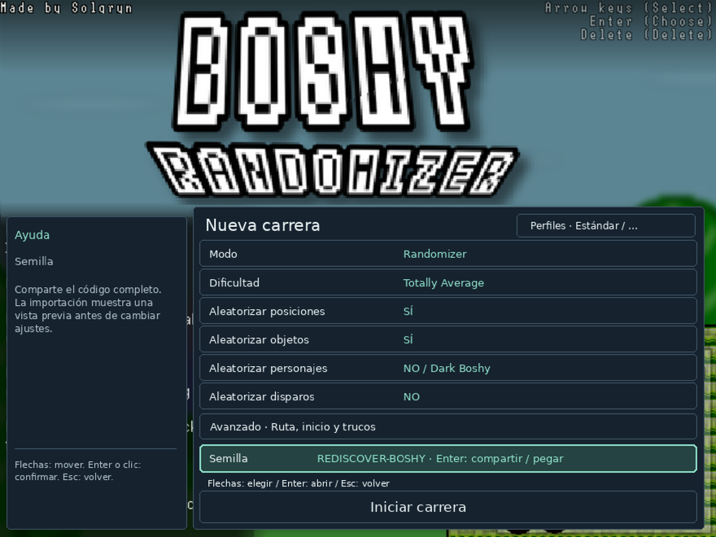

# Boshy renace.

[English](README_EN.md) · [Deutsch](README_DE.md) · [Русский](README_RU.md) · [Español](README_ES.md) · [日本語](README_JP.md)

**Redescubre Boshy. Una nueva aventura con cada semilla.**

Vuelve a sacar *I Wanna Be The Boshy* del cajón. Sus mundos, jefes y secretos te esperan en otro orden: crea una ruta aleatoria, persigue una lista de objetivos o comparte tu semilla con amigos. Añade algunas sorpresas opcionales y vuelve a descubrir un juego que creías conocer.

[Descargar DEB para Linux](https://github.com/THXel/Boshy-Randomizer/releases/download/v2026.10.15/boshy-randomizer_2026.10.15-1_amd64.deb) · [Versión y sumas de verificación](https://github.com/THXel/Boshy-Randomizer/releases/tag/v2026.10.15)

**Linux Mint 22.x / Ubuntu 24.04 · amd64 · X11**
**La versión actualizada para Windows llegará más adelante.** Las descargas antiguas de Windows pertenecen al randomizer anterior.


## Elige tu aventura

| Modo | Tu partida |
| --- | --- |
| **Randomizer** | Mezcla destinos de niveles y jefes, y reparte objetos y personajes entre los cofres. Elige los grupos en Advanced; recomendamos siete niveles y siete jefes. |
| **Target Select** | Una lista aleatoria de objetos con cantidad ajustable y jefes opcionales. Cambian las posiciones; los objetos conservan sus ubicaciones originales. Solgryn espera cuando completes los objetivos. |

Tres archivos independientes conservan el progreso y los personajes desbloqueados de cada partida. Configura o continúa desde el menú original. Los códigos compactos de semilla incluyen semilla y ajustes, con vista previa y validación al importar.

## Nuevas formas de jugar

- **45 puntos de ruta seleccionables**, con niveles divididos, minijefes y encuentros beta como Ridley, Questionmark y Old Sonic. Las transiciones utilizan el estado del juego, no la detección de píxeles.
- Cambios opcionales de personaje y **proyectiles con su efecto de disparo**: por punto, por muerte, ambos o a intervalos aleatorios con un límite configurable.
- Mezcla opcional de **45 temas musicales** de niveles y jefes.
- Personajes, fondos, suelos y efectos sutiles de la introducción que cambian al iniciar. No alteran la semilla.
- Hacks: ocultar ventanas de objetos, desactivar el fantasma del cursor, saltar introducciones, acortar animaciones de cofres, disparo automático, jefes con 1 HP y God Mode.
- Una rara **araña sorpresa**, activada inicialmente en partidas nuevas: aparece sin aviso cada 5–30 minutos de juego activo, incluso en combates. Desactívala en **Advanced → Hacks** y aplica los cambios; se recordará para futuras partidas hasta que la vuelvas a activar. Las partidas guardadas y las semillas importadas conservan sus propios ajustes.
- Tracker compacto en una ventana separada, iconos, copia de semilla, resultados tras Solgryn y diagnóstico opcional con **Ctrl+Alt+D**, incluida la exportación de grabaciones.


## Instala y juega

Descarga el DEB, cierra el randomizer antes de actualizar e instala:

```sh
sudo apt install ./boshy-randomizer_2026.10.15-1_amd64.deb
```

Abre **Boshy Randomizer** desde el menú de aplicaciones. La primera vez, selecciona tu **carpeta o ZIP de Boshy** compatible. Se crea una copia privada; tus archivos originales no se modifican ni se importan. Elige una ranura y configura la partida.

**El juego original no está incluido.** APT instala Wine, Lutris y las bibliotecas necesarias. La configuración inicial descarga y verifica Wine Staging 11.2 WoW64 o reutiliza una copia idéntica. Necesita internet para las dependencias y esa descarga; Lutris no tiene que permanecer abierto.

Datos: `~/.local/share/boshy-randomizer/`. Actualizar o desinstalar el paquete conserva las partidas. Las instalaciones de desarrollo no se migran automáticamente. [Más información](../docs/LINUX_PACKAGE.md).

## Idiomas y pruebas

La interfaz detecta inglés, alemán, ruso, español y japonés; usa inglés si el idioma no es compatible. Los registros de actualización siguen en inglés; diálogos originales e identidades de personajes no se traducen.



180 pruebas automáticas superadas. Los 45 puntos se cargaron y reiniciaron en el juego; Questionmark, Ridley, Old Sonic y Solgryn se completaron con hacks de entrenamiento. También se comprobaron el temporizador de la araña, guardado/carga y resultados. No se han completado todas las rutas y combinaciones. [Alcance de las pruebas](../docs/RELEASE_PREPARATION.md).

Un proyecto de fans de **THXel y la comunidad de speedrunning de Boshy**. Juego original de **Solgryn / Grynsoft**.

[Cambios](../CHANGELOG.md) · [Compilación](../docs/LINUX_PACKAGE.md#building) · [Informar de un error](https://github.com/THXel/Boshy-Randomizer/issues)

Código actual: `native-linux/`. PinguLexa/OBS se mantiene por separado. [Versión del juego y recursos](../docs/LINUX_PACKAGE.md#game-and-assets) · [Créditos](../Custom/License.txt).
