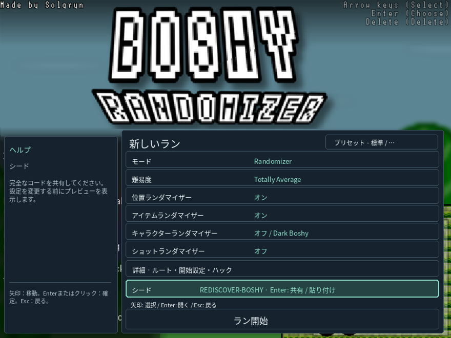

# Boshyを、もう一度。

[English](README_EN.md) · [Deutsch](README_DE.md) · [Русский](README_RU.md) · [Español](README_ES.md) · [日本語](README_JP.md)

**シードが変われば、冒険も変わる。**

久しぶりに *I Wanna Be The Boshy* を起動してみませんか。おなじみのステージ、ボス、隠しエリアを、新しい順番で楽しめます。ランダムな目標に挑戦したり、友達とシードを共有したり。任意の追加要素で、遊び慣れたBoshyにも驚きが生まれます。

[Linux版DEBをダウンロード](https://github.com/THXel/Boshy-Randomizer/releases/download/v2026.10.15/boshy-randomizer_2026.10.15-1_amd64.deb) · [リリースとチェックサム](https://github.com/THXel/Boshy-Randomizer/releases/tag/v2026.10.15)

**Linux Mint 22.x / Ubuntu 24.04 · amd64 · X11**
**更新版のWindows対応は後日公開予定です。** 既存のWindows版は旧ランダマイザーです。


## 遊び方を選ぶ

| モード | 内容 |
| --- | --- |
| **Randomizer** | ステージとボスの行き先をシャッフル。宝箱の報酬にはアイテムとキャラクターが混在します。Advancedで候補を選択でき、推奨設定はステージ7つとボス7体です。 |
| **Target Select** | 指定した個数のアイテム目標をランダムに選び、任意でボス目標も追加。移動先はランダムですが、アイテムの配置は元のままです。目標達成後にSolgrynへ進みます。 |

3つの独立したセーブスロットで、進行状況とキャラクター解放を別々に管理します。新規設定も続きからの再開も、元のゲームメニューから操作できます。短い **共有シードコード**にシードと設定が含まれ、読み込み時は内容確認と形式チェックが行われます。

## 新しい楽しみ方

- **45か所のルートポイント**。分割ステージ、ミニボス、Ridley・Questionmark・Old Sonicなどのベータ版ボスを選択可能。画面のピクセルではなくゲームの状態で移動を判定します。
- キャラクター変更と、**弾および発射エフェクト**のランダム化。移動時、死亡時、両方、または上限を設定できるランダムな時間間隔から選べます。
- ステージとボスの**45曲をまとめてシャッフル**する音楽オプション。
- 起動ごとに変化するイントロのキャラクター、背景、足場と控えめな演出。見た目の変化はシードに影響しません。
- アイテムのポップアップ抑制、マウスゴースト無効化、ボスのイントロ省略、宝箱演出短縮、連射、ボスHP1、God Modeなどの設定。
- 新規プレイでは**クモのサプライズ**が初期状態で有効。実際のプレイ時間で5～30分のランダムな間隔で、ボス戦でも予告なく現れます。**Advanced → Hacks**で無効にして適用すると、再び有効にするまで新規プレイの既定値として記憶されます。既存セーブと読み込んだシードは、それぞれの設定を使います。
- 別ウィンドウの小さなライブトラッカー、収集アイコン、シードのコピー、Solgryn撃破後の結果画面。**Ctrl+Alt+D**で診断と記録の書き出しができます。


## インストール

DEBをダウンロードし、更新時はランダマイザーを終了してからインストールします。

```sh
sudo apt install ./boshy-randomizer_2026.10.15-1_amd64.deb
```

アプリケーションメニューから **Boshy Randomizer** を起動してください。初回は対応するBoshyの**フォルダーまたはZIP**を指定します。専用コピーを作成するため、元のセーブデータは変更も取り込みもされません。その後スロットと設定を選びます。

**元のゲーム本体は含まれていません。** Wine、Lutrisと必要なライブラリは依存関係としてインストールされます。初回設定では検証済みのWine Staging 11.2 WoW64をダウンロードするか、同一の既存コピーを使用します。依存関係と初回ダウンロードにはインターネットが必要です。Lutrisを開いたままにする必要はありません。

保存先は `~/.local/share/boshy-randomizer/` です。パッケージの更新・削除でもユーザーデータは残ります。開発用インストールは自動移行しません。[詳細](../docs/LINUX_PACKAGE.md)。

## 言語と検証

英語・ドイツ語・ロシア語・スペイン語・日本語をシステム設定から検出し、未対応の言語では英語を使用します。更新履歴は英語のままです。元のゲームの台詞、画像、キャラクター名は翻訳しません。



自動テスト180件が成功。45か所すべてでゲーム内の読み込みとリセットを確認し、Questionmark、Ridley、Old Sonic、Solgrynは練習用設定を使って撃破を確認しました。クモのタイマー、保存・再開、結果表示も実機で検証しています。すべてのルートや設定の組み合わせを通しでクリアしたという意味ではありません。[検証範囲](../docs/RELEASE_PREPARATION.md)。

**THXelとBoshyスピードランコミュニティ**によるファンプロジェクト。オリジナルゲーム：**Solgryn / Grynsoft**。

[更新履歴](../CHANGELOG.md) · [ビルド方法](../docs/LINUX_PACKAGE.md#building) · [不具合の報告](https://github.com/THXel/Boshy-Randomizer/issues)

現行ソースは `native-linux/`。PinguLexa/OBS連携は別途提供されます。[対応ゲームと素材](../docs/LINUX_PACKAGE.md#game-and-assets) · [クレジット](../Custom/License.txt)。
