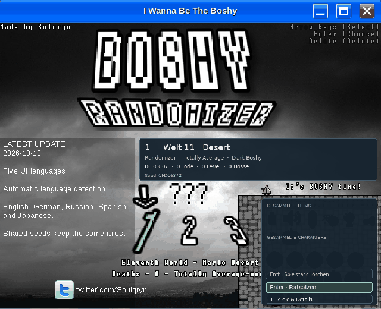
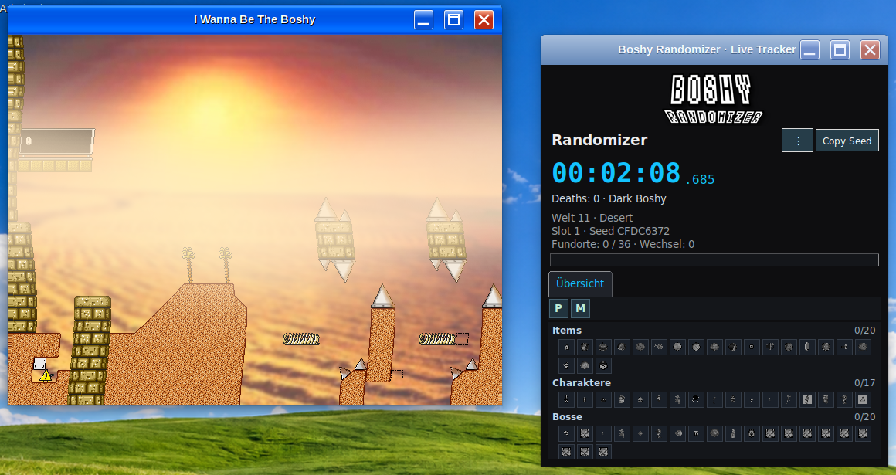

# Boshy Randomizer — Русский

[Linux download — 2026.10.13 RC1](https://github.com/THXel/Boshy-Randomizer/releases/tag/v2026.10.13-rc1) · [DEB](https://github.com/THXel/Boshy-Randomizer/releases/download/v2026.10.13-rc1/boshy-randomizer_2026.10.13-2_amd64.deb)

Текущая версия встроена в оригинальное анимированное меню Boshy: три независимых сохранения, Randomizer и Target Select, общие BR2-сиды, расширенные настройки уровней и боссов, смешанные награды, отдельный трекер и окно отладки по Ctrl+Alt+D.

## Установка Linux

Пакет Debian предназначен для Linux Mint 22.x / Ubuntu 24.04, amd64, X11. **Обновлённая версия Windows появится позже.** Файлы Windows в корне репозитория относятся к старой версии.

```sh
sudo apt install ./boshy-randomizer_2026.10.13-2_amd64.deb
```

Wine, Lutris и необходимые библиотеки устанавливаются как зависимости. Запустите **Boshy Randomizer** из меню приложений и выберите папку Boshy или ZIP с игрой. **Сама игра не входит в пакет и не скачивается.** Установщик проверяет версию и создаёт отдельную копию, не изменяя исходные сохранения и настройки.

При первом запуске автоматически загружается Wine Staging 11.2 WoW64 (около 72 МиБ), проверяется контрольная сумма и создаётся отдельная среда Wine. Идентичная установленная версия Lutris используется повторно. Для зависимостей и первой загрузки Wine нужен интернет; держать Lutris открытым во время игры не требуется.

Данные: `~/.local/share/boshy-randomizer/`. Удаление пакета сохраняет пользовательские данные. Предыдущая версия для разработчиков автоматически не переносится. Интерфейс поддерживает английский, немецкий, русский, испанский и японский; для других языков используется английский. Журнал обновлений всегда на английском. Интеграция PinguLexa/OBS устанавливается отдельно.

[English overview](../README.md) · [Сборка и проверки](../docs/LINUX_PACKAGE.md)

## Актуальные снимки экрана




