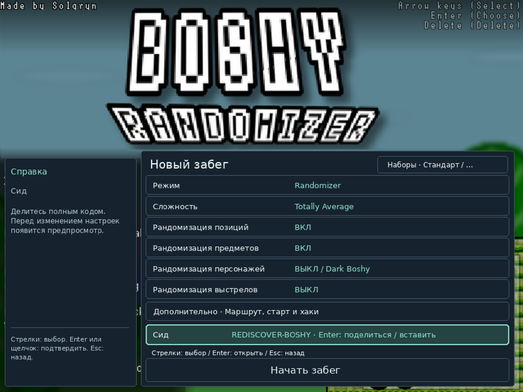

# Boshy возвращается.

[English](README_EN.md) · [Deutsch](README_DE.md) · [Русский](README_RU.md) · [Español](README_ES.md) · [日本語](README_JP.md)

**Открой Boshy заново. Каждый сид — новое приключение.**

Пора снова запустить *I Wanna Be The Boshy*. Знакомые миры, боссы и секреты складываются в новый маршрут. Собирай случайные цели, делись сидом с друзьями и добавляй необязательные сюрпризы.

[Скачать DEB для Linux](https://github.com/THXel/Boshy-Randomizer/releases/download/v2026.10.15/boshy-randomizer_2026.10.15-1_amd64.deb) · [Релиз и контрольные суммы](https://github.com/THXel/Boshy-Randomizer/releases/tag/v2026.10.15)

**Linux Mint 22.x / Ubuntu 24.04 · amd64 · X11**
**Обновлённая версия для Windows выйдет позже.** Старые Windows-сборки относятся к прежнему рандомайзеру.


## Выбери приключение

| Режим | Как проходит забег |
| --- | --- |
| **Randomizer** | Случайные переходы между уровнями и боссами; в сундуках перемешаны предметы и персонажи. В Advanced можно настроить набор этапов. Рекомендуется семь уровней и семь боссов. |
| **Target Select** | Случайный список предметов заданной длины и необязательные цели-боссы. Позиции меняются, предметы остаются на своих местах. После выполнения целей открывается бой с Solgryn. |

Три независимых слота сохраняют прогресс и открытых персонажей каждого забега. Настройка и продолжение — прямо в оригинальном меню. Компактный код сида содержит сид и настройки; перед импортом доступны проверка и предпросмотр.

## Что нового

- **45 выбираемых точек маршрута**: разделённые уровни, мини-боссы и бета-боссы Ridley, Questionmark, Old Sonic. Переходы определяются по состоянию игры, а не по пикселям.
- Смена персонажа и случайный **вид снарядов вместе с эффектом выстрела**: при переходе, смерти, обоих событиях или через случайные интервалы с настраиваемым пределом.
- Необязательное перемешивание **45 музыкальных тем** уровней и боссов.
- Случайные персонажи, фон и платформы заставки с небольшими эффектами. Оформление не меняет сид.
- Хаки в Advanced: отключение всплывающих эффектов предметов и призрака курсора, пропуск вступлений боссов, сокращение анимации сундуков, автоогонь, 1 HP у боссов и God Mode.
- Редкий **паук-сюрприз** изначально включён для новых забегов: без предупреждения, через 5–30 минут активной игры, в том числе у боссов. Отключи его в **Advanced → Hacks** и примени изменения — выбор сохранится для будущих забегов до повторного включения. Старые сохранения и импортированные сиды используют собственные настройки.
- Отдельный компактный live-трекер с иконками и копированием сида, итоги после Solgryn и диагностическое окно **Ctrl+Alt+D** с экспортом записей.


## Установка

Скачай DEB, закрой рандомайзер перед обновлением и установи пакет:

```sh
sudo apt install ./boshy-randomizer_2026.10.15-1_amd64.deb
```

Запусти **Boshy Randomizer** из меню приложений. При первом запуске выбери свою совместимую **папку Boshy или ZIP**. Создаётся отдельная копия игры; исходные сохранения не изменяются и не импортируются. Затем выбери слот и настройки забега.

**Оригинальная игра не входит в пакет.** Wine, Lutris и библиотеки устанавливаются как зависимости. Первичная настройка загружает проверенный Wine Staging 11.2 WoW64 или использует идентичную установленную копию. Для этого нужен интернет; держать Lutris открытым не требуется.

Данные: `~/.local/share/boshy-randomizer/`. Обновление и удаление пакета сохраняют пользовательские файлы. Установки для разработки автоматически не переносятся. [Подробности установки](../docs/LINUX_PACKAGE.md).

## Языки и проверки

Интерфейс определяет английский, немецкий, русский, испанский и японский язык системы; для остальных используется английский. История обновлений остаётся на английском, исходные диалоги и имена не переводятся.



180 автоматических тестов пройдены. Все 45 точек проверены загрузкой и сбросом в игре; Questionmark, Ridley, Old Sonic и Solgryn побеждены с тренировочными хаками. Проверены таймер паука, сохранение/загрузка и экран результатов. Это не полное прохождение всех маршрутов и комбинаций. [Область проверки](../docs/RELEASE_PREPARATION.md).

Фан-проект **THXel и сообщества спидраннеров Boshy**. Оригинальная игра: **Solgryn / Grynsoft**.

[Изменения](../CHANGELOG.md) · [Сборка из исходников](../docs/LINUX_PACKAGE.md#building) · [Сообщить об ошибке](https://github.com/THXel/Boshy-Randomizer/issues)

Актуальный код: `native-linux/`. Интеграция PinguLexa/OBS поставляется отдельно. [Версия игры и материалы](../docs/LINUX_PACKAGE.md#game-and-assets) · [Авторство ресурсов](../Custom/License.txt).
