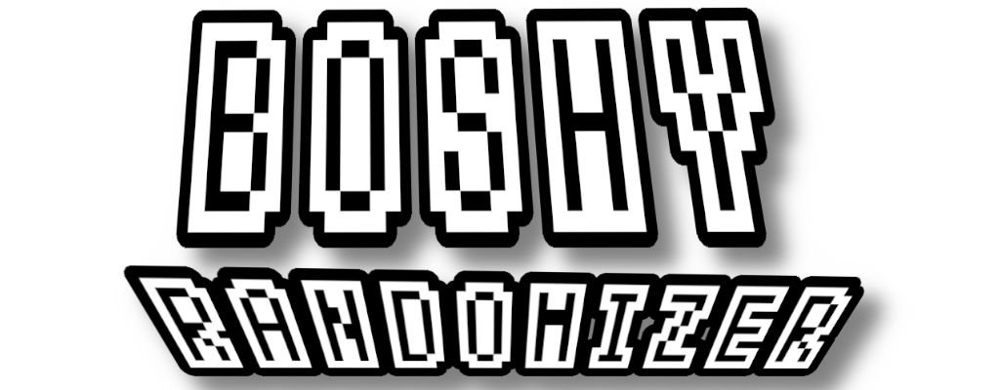
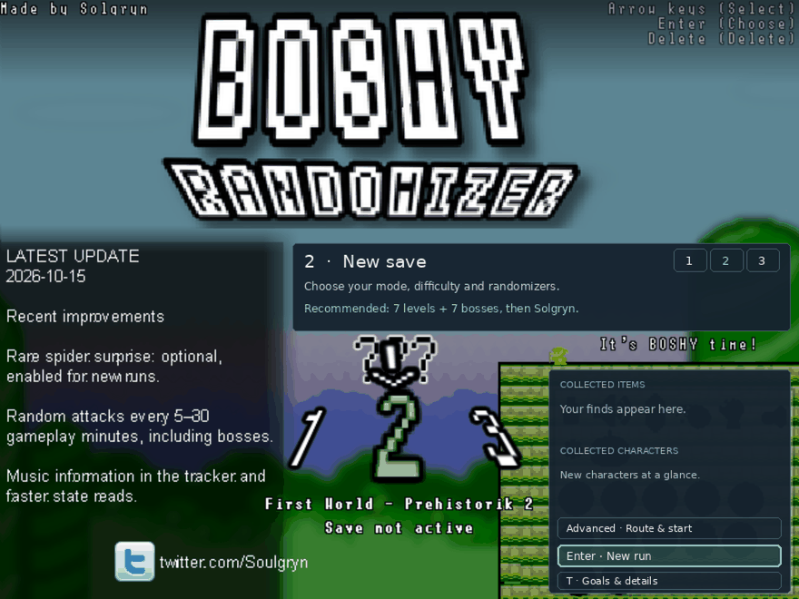
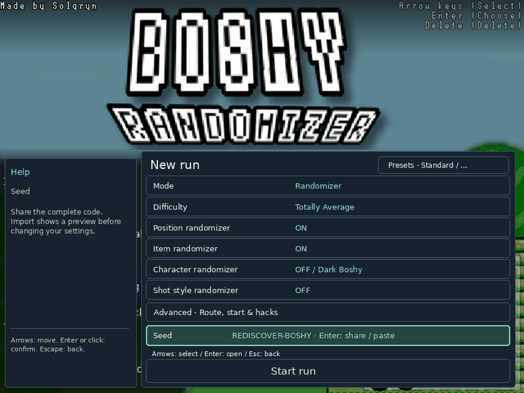

# Boshy возвращается.

**Открой Boshy заново. Каждый сид — новое приключение.**

[English](README_EN.md) · [Deutsch](README_DE.md) · [Español](README_ES.md) · [Русский](README_RU.md) · [日本語](README_JP.md)

[🌐 Website](https://thxel.github.io/Boshy-Randomizer/site/ru/) · [↓ Установщик Windows](https://github.com/THXel/Boshy-Randomizer/releases/download/v2026.10.18/BoshyRandomizer-2026.10.18-Windows-Setup-x64.exe) · [↓ DEB для Linux](https://github.com/THXel/Boshy-Randomizer/releases/download/v2026.10.18/boshy-randomizer_2026.10.18-1_amd64.deb) · [Релиз и контрольные суммы](https://github.com/THXel/Boshy-Randomizer/releases/tag/v2026.10.18)

Знакомые миры. Неожиданные пути. Вернись в I Wanna Be The Boshy: новые сочетания встреч, случайные награды и маршрут, которым можно поделиться.

> Нужна собственная папка Boshy или ZIP. Оригинальная игра не включена.
>
> [Скачать I Wanna Be The Boshy на Grynsoft](https://grynsoft.com/site/game/i-wanna-be-the-boshy)

[Режимы](#modes) · [Возможности](#features) · [Hacks](#hacks) · [Скачать](#download) · [Вопросы](#faq)

## Пять способов играть

| Mode | |
| --- | --- |
| **Randomizer** | **Знакомая игра в новом порядке.** Перемешивай уровни и боссов, объединяй предметы и персонажей в общий пул наград сундуков. В Advanced выбираются списки и количество. Рекомендуется семь уровней и семь боссов, по возможности поочерёдно, затем Solgryn. |
| **Target Select** | **Список целей. Неизвестный путь.** Собери случайный список оригинальных предметов; количество и обязательные боссы настраиваются. Меняются точки назначения, но не награды. Выполни цели, чтобы открыть финал с Solgryn. |
| **Normal** | **Твой путь. Твои правила.** Оригинальное прохождение и сундуки. Можно выбрать стартового персонажа, ротацию и хаки; сначала эти дополнения выключены. |
| **Boss Rush** | **Сразу к сражениям.** Выбирай боссов и число встреч — по умолчанию семь. После них тебя ждёт Solgryn. |
| **Level Rush** | **Миры становятся испытанием.** Выбирай уровни и количество участков — по умолчанию семь. После маршрута следует финал с Solgryn. |

## Каждый забег — по-твоему

### Больше обычного маршрута

Разделённые миры, мини-боссы, секреты и бета-бои с Ridley, Questionmark, Bomberman и Old Sonic. Список выбирается в Advanced. Переходы используют состояние игры вместо пикселей.

### Предметы и персонажи вместе

Любой сундук может дать предмет или персонажа. Необязательная ротация использует доступных героев и добавляет новых после получения. Ручной выбор F3 при ротации заблокирован.

### Сиды для друзей

Компактный код содержит сид и настройки забега. Копируй, вставляй, проверяй и просматривай его в меню или создавай новый. Для сравнения забегов нужна одинаковая версия.

### Три слота, три приключения

Каждый слот хранит отдельный забег и открытия персонажей. В меню видны место, сложность, герой и прогресс; там же можно продолжить, создать или удалить сохранение.

### Трекер рядом с игрой

Отдельное окно с таймером, смертями, местом, предметами, персонажами, боссами и копированием сида. Оно учитывает режим, выделяет цели Target Select и анимирует новые находки.

### Финал без спешки

После Solgryn появляется отложенный полупрозрачный итог со статистикой и копируемым сидом. Анимация смерти и титры продолжаются.

### Знакомая игра, новый облик

Персонажи и декорации интро меняются при запуске. Sprite Chaos перемешивает проверенные фоны с анимированным параллаксом, декор и материалы платформ. Слои настраиваются отдельно, фон можно затемнить. Перекраска врагов и боссов — бета; формы, атаки и коллизии сохраняются.

### Новые выстрелы. Новый звук.

Меняй снаряд и эффект выстрела независимо от героя: после участка, смерти, обоих событий или в случайный момент внутри выбранного интервала. Секунды и минуты настраиваются; по умолчанию пять минут.

Music Shuffle объединяет музыку уровней и боссов по сиду. Локальные наборы Kamilia 3 и WannaFest22 могут заменять также подходящие звуки интро, меню, смерти и титров. Выбор сохраняется; треки для перемешивания должны быть длиннее 30 секунд. Дополнительные наборы не включены.

## Немного помощи. Немного хаоса.

В Advanced → Hacks выбирай дополнения для тренировки, разнообразия или неожиданностей.

- Убрать окна предметов
- Отключить призрак мыши
- 1 HP у босса на уязвимую фазу
- God Mode
- Автоогонь при удержании кнопки
- Зеркальный режим
- Смена героя после смерти
- Автопропуск интро боссов
- Укоротить анимации сундуков
- Перемешать музыку
- Настроить Sprite Chaos
- Сюрприз с пауком

> Паук изначально включён в новых забегах randomizer: нападение без предупреждения каждые 5–30 минут активной игры, в том числе у боссов. Отключи и примени настройку, чтобы запомнить выбор для будущих забегов. Сохранения и импортированные сиды оставляют свои правила.

### Удобно играть

- Мышь и клавиатура; Enter подтверждает выбор.
- Меню подстраивается под окно, размер текста регулируется отдельно.
- Размеры под монитор в оригинальном Options; растянутый полный экран сохранён.
- Английский, немецкий, русский, испанский и японский по языку системы; запасной — английский. Журнал обновлений остаётся английским.

## Выбери платформу

| | Download | |
| --- | --- | --- |
| **Windows** | [Установщик Windows](https://github.com/THXel/Boshy-Randomizer/releases/download/v2026.10.18/BoshyRandomizer-2026.10.18-Windows-Setup-x64.exe) | Предварительная версия Windows · x64 |
| **Linux** | [DEB для Linux](https://github.com/THXel/Boshy-Randomizer/releases/download/v2026.10.18/boshy-randomizer_2026.10.18-1_amd64.deb) | Linux Mint 22 / Ubuntu 24.04 · X11 · amd64 |

[Релиз и контрольные суммы](https://github.com/THXel/Boshy-Randomizer/releases/tag/v2026.10.18) · [Windows](../docs/WINDOWS_PACKAGE.md) · [Linux](../docs/LINUX_PACKAGE.md)

### От загрузки до первого забега

1. Скачай установщик Windows или DEB для Linux.
2. Установи и открой Boshy Randomizer из меню приложений. В Windows можно добавить ярлык на рабочий стол.
3. Выбери поддерживаемую папку Boshy или ZIP, слот и настройки.

Создаётся отдельная копия игры. Оригинальные сохранения не изменяются; обновление и удаление программы сохраняют забеги.

## Полезно знать

Можно использовать на стриме?

Трекер — отдельное окно для размещения рядом с игрой или захвата в OBS.

Что делать при проблеме с переходом?

Ctrl+Alt+D открывает текущие данные, тестовые действия и экспорт записей. Ctrl+Alt+M отмечает проблему и сохраняет недавнюю историю без открытия окна. Отчёт может включать снимок только игры.

Всё ли проверено?

369 автоматических тестов пройдены. Установка, обновление, удаление, сохранность данных и продолжение проверены в Windows с активным Defender. Проверки Linux описаны в релизе. Не все маршруты и сочетания пройдены целиком.

Что значит предварительная версия Windows?

Установщик не подписан, проверен в Windows 10 x64. Windows 11, не-ASCII пути аккаунта, физический 4K и смешанный DPI требуют проверки. Не отключай антивирус.

Есть онлайн-режим?

Это одиночный рандомайзер. Старое онлайн-меню отключено. Делись сидами, чтобы проходить сопоставимые маршруты с друзьями.

---

Фан-проект THXel и сообщества спидраннеров Boshy. Оригинальная игра — Solgryn / Grynsoft.

[Сообщить о проблеме](https://github.com/THXel/Boshy-Randomizer/issues) · [Изменения](../CHANGELOG.md) · [Credits](../Custom/License.txt)
